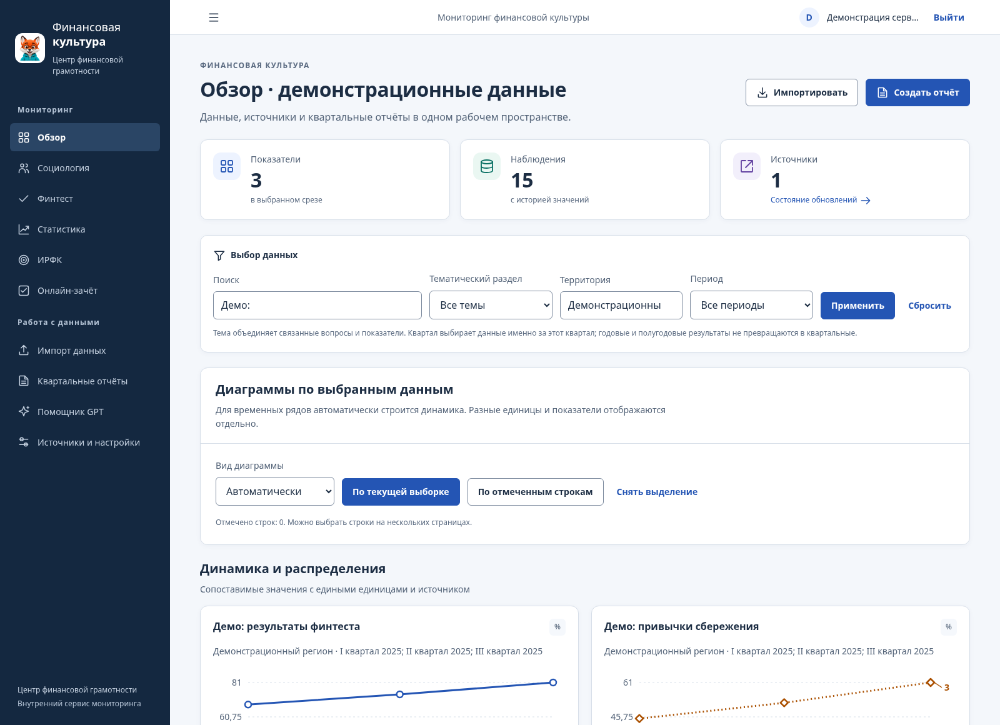
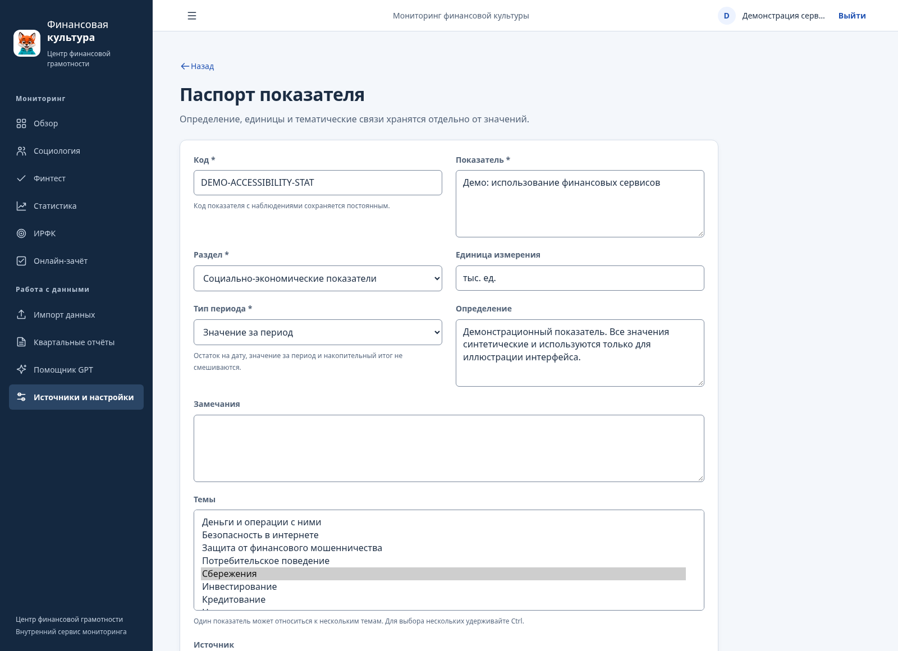
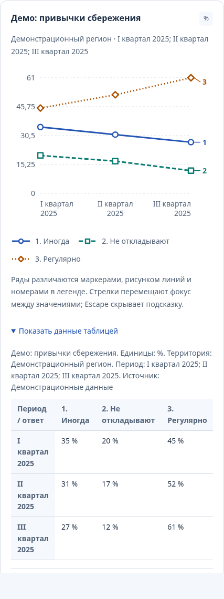
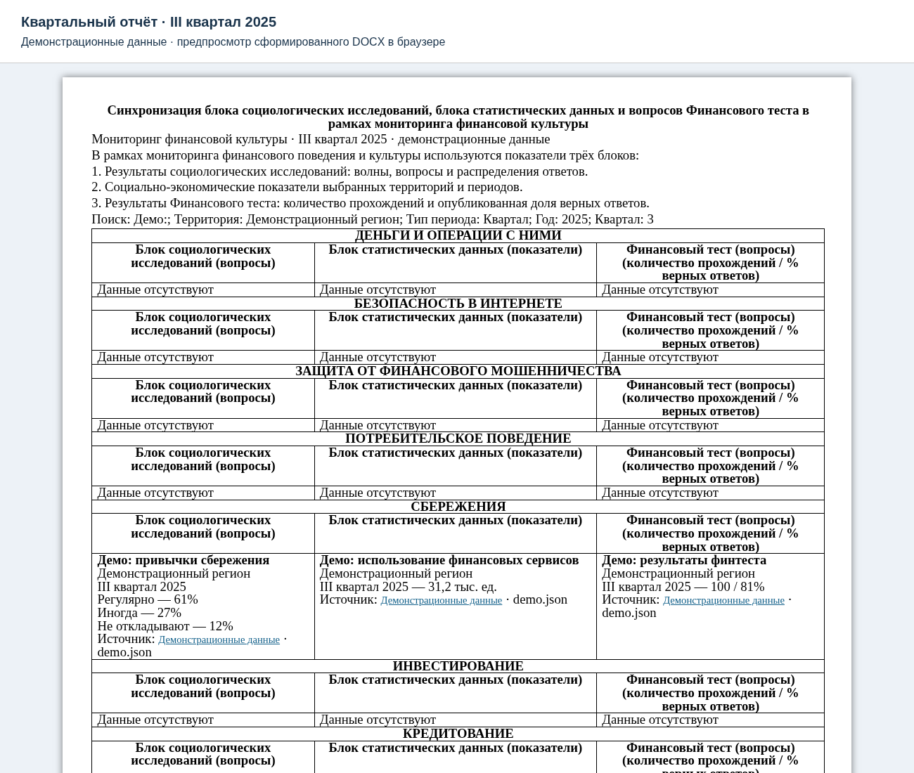

# Мониторинг финансовой культуры

[](https://github.com/kd170703/product/actions/workflows/ci.yml)

Внутренний сервис Центра финансовой грамотности для ведения показателей и подготовки квартального отчёта. Данные из исследований, финтеста и официальной статистики собираются в одном реестре, сохраняют ссылки и историю изменений и выгружаются в Word и Excel.

**Python 3.12 · Django · PostgreSQL 17 · Docker Compose.** Интерфейс на русском языке. Месячное обновление выполняет отдельный фоновый процесс.

## Как выглядит сервис

На скриншотах используются демонстрационные данные. Word показан в браузерном предпросмотре сформированного DOCX.

| Обзор мониторинга | Паспорт показателя |
| --- | --- |
|  |  |
| **Диаграммы по выбранным данным** | **Квартальный отчёт** |
|  |  |

## Что можно делать

- Вести социологию, финтест, статистику, компоненты ИРФК и онлайн-зачёт в 13 тематических разделах.
- Импортировать Excel с предпросмотром, находить данные по кварталу, году, территории и теме.
- Строить диаграммы по всей выборке или отмеченным строкам; сравнивать сопоставимые периоды.
- Сохранять версии источников и отдельные ручные поправки с автором и обоснованием.
- Выпускать редактируемый Word и типизированный Excel; ранее выпущенные отчёты остаются неизменными.
- Настраивать источники, расписание и необязательное извлечение предложений через OpenAI API.

## Запуск на сервере организации

Нужны Linux-сервер, Docker Engine с Compose, Python 3 и Git. Домен должен указывать на сервер; порты 80 и 443 — быть доступны для выпуска HTTPS-сертификата. Размещение базы, файлов и копий выбирается в инфраструктуре организации в России.

```sh
git clone https://github.com/kd170703/product.git
cd product
sh scripts/setup-server.sh monitoring.organization.ru
sh scripts/server.sh pull
sh scripts/server.sh up -d
```

Замените пример домена на свой. Настройка создаёт случайные секреты локально; сервис получает готовые образы из GHCR. Если пакет закрытый, сначала требуется [вход в реестр образов](docs/image-publishing.md). Первого администратора создайте командой `sh scripts/server.sh exec web python manage.py createsuperuser`.

Откройте свой HTTPS-адрес, настройте второй фактор и загрузите Excel через «Импорт данных». Caddy обслуживает HTTPS; база и файлы сохраняются в томах. Отдельные процессы обновляют источники и ежедневно создают зашифрованные резервные копии.

[Полная инструкция для сервера](docs/server-deployment.md) · [Локальная установка в Windows без обязательного Git](docs/install-windows.md).

## Документация

| Задача | Инструкция |
| --- | --- |
| Установить сервис в Windows | [Установка и диагностика первого запуска](docs/install-windows.md) |
| Импортировать данные и настроить источники | [Подключения и форматы](docs/connectors.md) |
| Настроить пользователей | [Роли и права](docs/roles.md) |
| Обновить сервис или восстановить резервную копию | [Эксплуатация](docs/operations.md) |
| Настроить OpenAI API | [GPT](docs/gpt.md) |
| Разместить на внутреннем сервере | [Сервер, Caddy и обновление образов](docs/server-deployment.md) |
| Защитить вход и настроить второй фактор | [Безопасность](docs/security.md) |
| Настроить ежедневные копии и восстановление | [Резервное копирование](docs/backups.md) |
| Учесть размещение персональных данных | [Инфраструктура и требования к данным](docs/data-localization.md) |
| Проверить методику и происхождение | [Методические правила](docs/source-methodology.md) |
| Изменить код | [Разработка и проверки](CONTRIBUTING.md) |

## Данные и доступы

Рабочие документы, выгрузки, база и секреты загружаются отдельно и не входят в публичный репозиторий. Подключения Росстата и ФНС зависят от доступности официальных файлов; полный ИРФК — от согласованной методики. GPT требует отдельного включения в серверных настройках и ключа; извлечённые записи подтверждает сотрудник.

Актуальные результаты и границы проверки: [протокол](docs/verification.md). История изменений: [CHANGELOG](CHANGELOG.md).

## Условия использования

Лицензия для повторного использования пока не выбрана владельцем проекта. Публикация репозитория сама по себе не определяет условия распространения кода.
