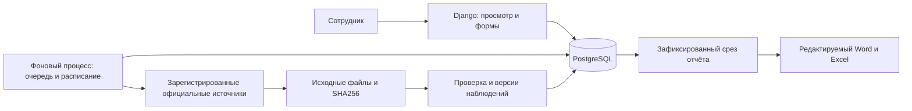

# Архитектура первой версии

Django обслуживает русские шаблоны и формы. PostgreSQL хранит справочники, наблюдения, версии, очередь и снимки отчётов. Файлы публикаций и выпущенных отчётов находятся в отдельном постоянном томе. Отдельный процесс `runworker` опрашивает очередь и месячное расписание в часовом поясе `Europe/Moscow`; открытый браузер не нужен.

## Основные сущности

- `Indicator`, `Topic`, `TopicAlias`: паспорта и канонические тематические связи; одно наблюдение связано с несколькими темами через показатель.
- `Study`, `Wave`, `Question`, `QuestionVersion`, `AnswerOption`: исследование, волны, текст вопроса и версии вариантов ответа.
- `Source`, `Publication`: параметры подключения и сохранённые исходные публикации с контрольной суммой, адресом и датами.
- `Observation`: постоянный ключ измерений; `ObservationVersion`: исходное значение каждой редакции с происхождением, единицей, статусом и автором.
- `ManualCorrection`: отдельная поправка с обоснованием. Новая публикация сохраняет поправку и создаёт конфликт для явного решения сотрудником.
- `Methodology`, `Formula`: версия методики и ограниченный JSON-язык формул без выполнения произвольного Python.
- `ImportBatch`, `DataIssue`: предварительный просмотр, подтверждение и список вопросов качества.
- `LoadRun`: очередь PostgreSQL, попытки, журнал, срок исполнения и уникальное активное задание на источник.
- `ReportSnapshot`: неизменяемый материализованный срез, версии исходных данных и формул, DOCX и XLSX.

## Инварианты

Наблюдение определяется показателем, версией вопроса, вариантом ответа, волной, территорией, группой, типом и датами периода. При неизвестных датах сохраняется исходная подпись периода. Годовой период не меняется при ежемесячной проверке. Изменение единиц или опубликованного значения создаёт версию, а не второе наблюдение с теми же измерениями.

Числовой ноль, отсутствие данных и неприменимость имеют разные состояния, подтверждённые ограничениями PostgreSQL. Проценты не используются для восстановления неизвестных числителей. Расчёты не объединяют разные территории, группы, версии вопросов и пересекающиеся периоды без согласования.

Повторный файл с той же контрольной суммой не создаёт новые значения. Исправление по прежнему URL сохраняет новую публикацию. Перед записью проверяется весь набор; ошибка не заменяет последние корректные значения. PostgreSQL advisory lock и уникальное активное задание предотвращают параллельную обработку одного источника; истёкший срок исполнения допускает повтор после сбоя процесса.

Просмотр требует роли, изменения проходят через доменные функции и проверку прав; POST защищён CSRF. Исходные файлы доступны только через защищённые представления. История и выпущенные отчёты не редактируются через админку. Клиент не получает ключ OpenAI.

## Ограничения и развитие

Для нестандартного сайта нужен отдельный адаптер, а не только URL. Росстат и ФНС требуют сохранённых официальных файлов для окончательной проверки структуры. Мониторинг внешней доступности, ротация резервных копий, TLS и внутренний домен настраиваются при размещении на сервере организации. Текущие границы проверки описаны в [результатах проверки](verification.md), необходимые решения — в [вопросах владельцу](owner-questions.md).
